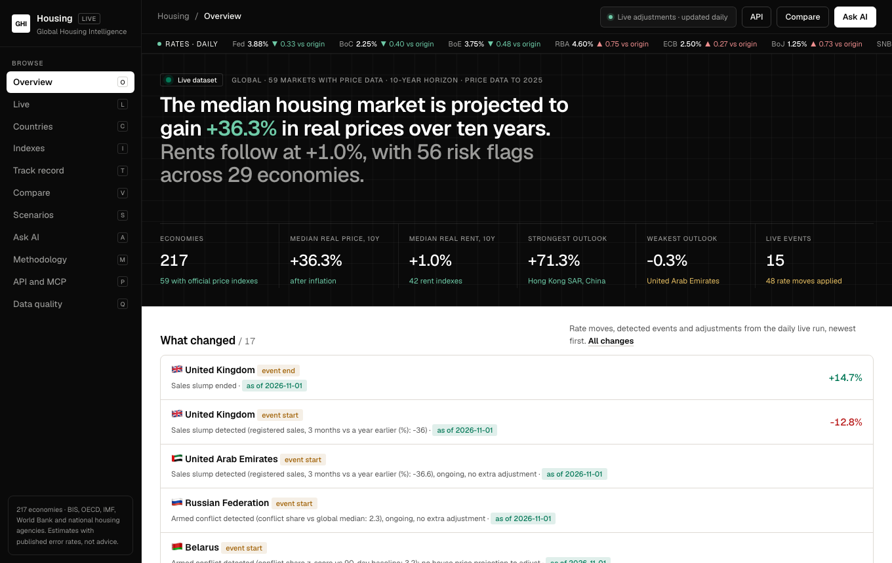
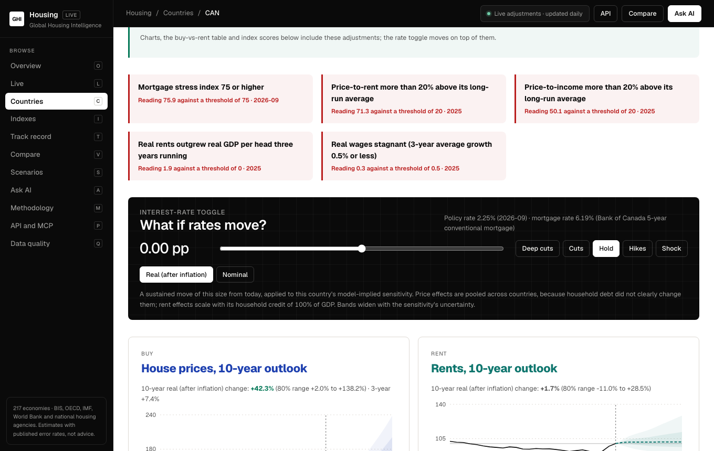
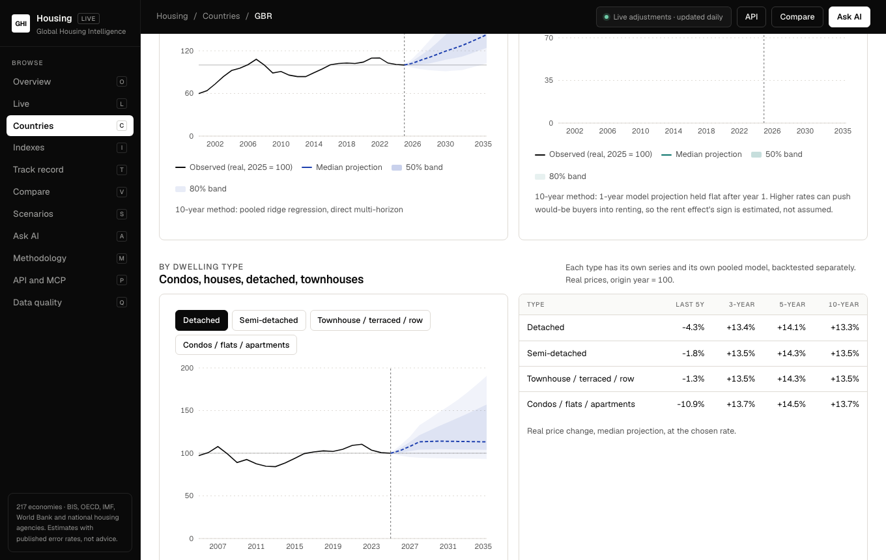
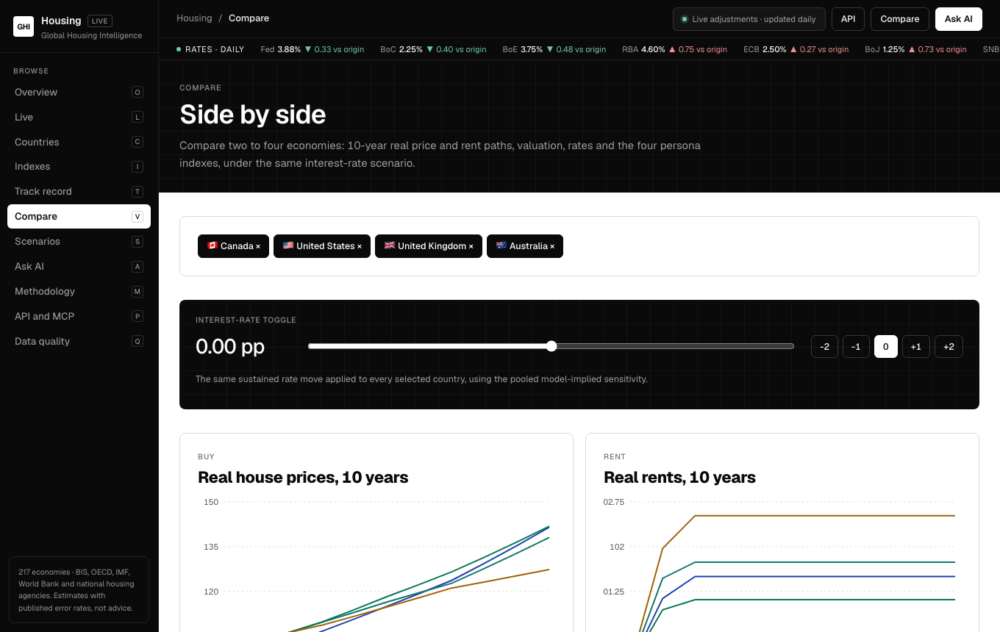
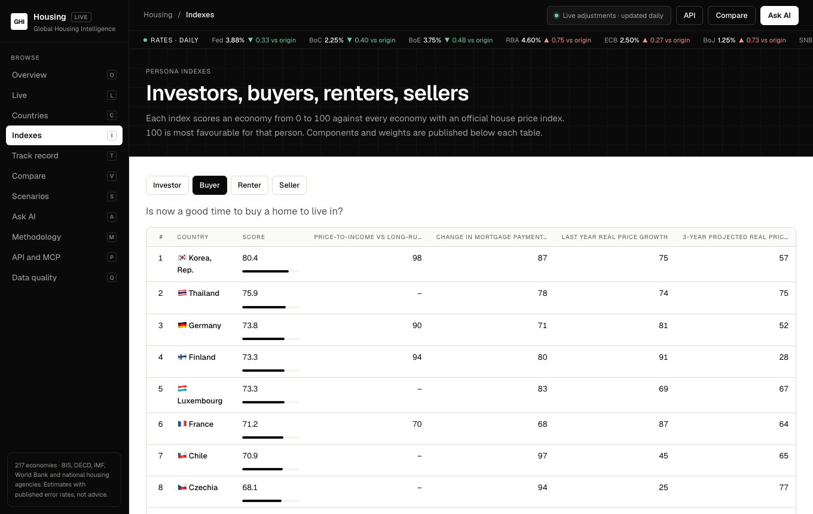
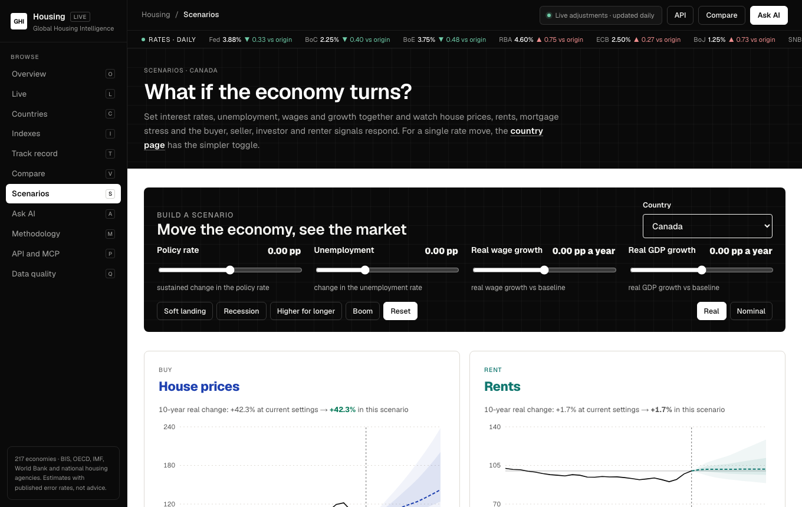
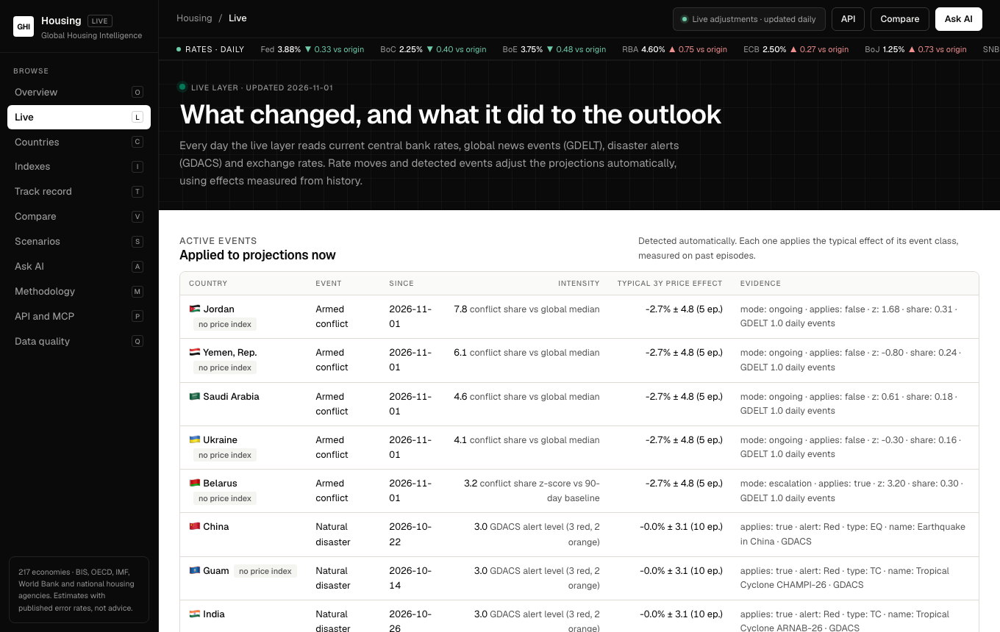

# Global Housing Intelligence

**Where house prices and rents go next, for every economy, with the error bars left in.**

[**Live site → global-housing-intelligence.vercel.app**](https://global-housing-intelligence.vercel.app)

[](https://global-housing-intelligence.vercel.app)
[](https://github.com/ankitmishra01/global-housing-intelligence/actions/workflows/ci.yml)
[](https://github.com/ankitmishra01/global-housing-intelligence/actions/workflows/refresh.yml)
[](https://github.com/ankitmishra01/global-housing-intelligence/actions/workflows/probe.yml)
[](https://global-housing-intelligence.vercel.app/quality)
[](LICENSE)



Global Housing Intelligence pulls official house price, rent, credit and interest-rate data from international institutions and national housing agencies into one database. It projects **house prices and rents 10 years ahead**, **adjusts them every day** for rate moves, conflicts, disasters, currency crises and sales slumps, and lets you **move interest rates, unemployment, wages and growth to see what changes**. It scores every market for **investors, buyers, renters and sellers**, with a published track record and a public API and MCP server.

It is the sibling of [global-economic-intelligence](https://github.com/ankitmishra01/global-economic-intelligence) ([live](https://g20-gamma.vercel.app)). It shares that app's brand and layout and follows the same rule. Statistical code produces every number and the browser renders it. An LLM may explain the numbers, but it never makes one up. A model that cannot beat a simple baseline on history is not shown as skilled. The page shows the baseline instead and says so.

---

## Contents

- [Who it is for](#who-it-is-for)
- [A quick tour](#a-quick-tour)
- [What is in the data](#what-is-in-the-data)
- [How the 10-year projections work](#how-the-10-year-projections-work)
- [The interest-rate toggle](#the-interest-rate-toggle)
- [Persona indexes](#persona-indexes)
- [Risk flags](#risk-flags)
- [Live adjustments](#live-adjustments)
- [Affordability, stress and signals](#affordability-stress-and-signals)
- [Scenarios and track record](#scenarios-and-track-record)
- [Ask AI](#ask-ai)
- [Public API and MCP server](#public-api-and-mcp-server)
- [Architecture](#architecture)
- [Project structure](#project-structure)
- [Run it yourself](#run-it-yourself)
- [Automation](#automation)
- [Testing](#testing)
- [Adding a country's national data](#adding-a-countrys-national-data)
- [Known limits](#known-limits)
- [FAQ](#faq)
- [Sources and attribution](#sources-and-attribution)

---

## Who it is for

| You are a… | The question it answers | Where to look |
|---|---|---|
| **Investor** | Which markets look best to hold housing in over 10 years, after risk? | `/indexes?persona=investor`, country fan charts, risk flags |
| **Buyer** | Is now a good time to buy, and what does a mortgage cost if rates move? | Country page: buy-vs-rent calculator and rate toggle |
| **Renter** | Where are rents likely to rise fastest relative to incomes? | `/indexes?persona=renter`, rent fan charts |
| **Seller** | Are prices stretched against history, and is the outlook weakening? | `/indexes?persona=seller`, valuation gaps |
| **Analyst / policy** | How do markets compare, and how reliable are the projections? | `/compare`, `/methodology` (live backtests) |

## A quick tour

### Country pages: the rate toggle, buy and rent fan charts

Drag the slider from −3 to +3 percentage points, or pick a preset (deep cuts, cuts, hold, hikes, shock). Every chart, the buy-vs-rent table and the four persona scores redraw instantly. Switch between real (after inflation) and nominal.



### Condos, houses, detached, semi-detached, townhouses

Where a source publishes prices by dwelling type, each type gets its own history and 10-year path. Each type comes from a pooled model trained and backtested on the type series.



### Compare up to four countries under the same rate scenario



### Indexes for investors, buyers, renters and sellers



### Scenarios: rates, unemployment, wages and growth together



### Live adjustments from rates and events



| Route | What you get |
|---|---|
| `/` | World map of projected 10-year real price change, strongest and weakest outlooks, persona leaders, risk register |
| `/countries` | All 217 economies, filterable by region, tier, rent coverage and national data |
| `/countries/[iso3]` | Rate toggle, buy and rent fan charts, dwelling types, buy-vs-rent calculator, persona scores, national agency data (Canada includes 9 cities), housing drivers |
| `/indexes` | League tables for each persona, with every component's percentile |
| `/countries/[iso3]/[region]` | City and region pages (Toronto, Paris, Dubai, Scotland, Amsterdam…), descriptive |
| `/countries/[iso3]/brief` | One-page brief to print or save as PDF; social cards for link previews |
| `/live` | Today's rate moves and detected events, what they changed, the event library |
| `/compare?c=CAN,AUS,GBR` | Two to four countries side by side under one rate scenario |
| `/scenario?c=CAN` | Move rates, unemployment, wages and growth together; presets such as Recession |
| `/track-record` | Pseudo-out-of-sample backtest record and the live forecast scorecard |
| `/api-docs` | Public JSON API, MCP server for Claude/ChatGPT, RSS feeds |
| `/methodology` | Sources, the **live** backtest table, rate sensitivities, flag thresholds, index weights, limits |
| `/quality` | Automated data quality checks (coverage, freshness, validity, cross-source consistency, projection integrity) — see [docs/DATA_QUALITY.md](docs/DATA_QUALITY.md) |
| `/ask` | Ask AI, grounded in the database, with a numeric guardrail |
| `/api/v1/*` | Cached public JSON |

## What is in the data

Everything lives in **Turso**. About 270,000 observations are refreshed monthly by a cloud job (live inputs daily), and nothing depends on a local machine.

| Source | What it gives | Coverage |
|---|---|---|
| **BIS** selected residential property prices (`WS_SPP`) | Real and nominal house price indexes, quarterly, many from the 1970s | ~57 economies |
| **BIS** detailed property prices (`WS_DPP`) | Prices by dwelling type: houses, detached, townhouses, flats/condos | ~25 economies |
| **BIS** total credit and credit gaps | Household credit as % of GDP, credit-to-GDP gap | ~43 |
| **BIS** central bank policy rates | Monthly policy rates (euro members take the ECB rate from their joining year) | ~58 |
| **OECD** Analytical House Prices | Rent index, price-to-income and price-to-rent vs long-run average | ~43 rent, ~25 valuation |
| **IMF** World Economic Outlook | Inflation and real GDP growth, history plus ~5-year forecasts | ~194 |
| **World Bank** WDI | Population and urban growth, urban share, income, lending and real rates, private credit, CPI | all 217 |
| **CMHC / Statistics Canada** | Two-bedroom rents and vacancy for 9 metros, housing starts, New Housing Price Index | Canada |
| **Bank of Canada** | 5-year conventional mortgage rate (posted), weekly | Canada |
| **FRED** (Census, BLS, Freddie Mac) | Median sales price, CPI rent, 30-year mortgage rate, starts, rental vacancy | United States |
| **Zillow Research** | Condo vs single-family typical values, typical market rent | United States |
| **HM Land Registry** | Average price by detached / semi-detached / terraced / flat, UK and four nations | United Kingdom |
| **Dubai Real Estate Data** (DLD open data, CC BY 4.0) | Monthly registered sales and median AED per sq ft, the official DLD price index, new-contract rents, gross yields; drives the Dubai sales-slump signal | Dubai (UAE) |
| **Australian Bureau of Statistics** | Mean dwelling price, national and by state | Australia |
| **INSEE, INE, CSO, CBS, SCB, SSB, BCB** | Regional and dwelling-type price indexes, sales volumes and prices | France, Spain, Ireland, Netherlands, Sweden, Norway, Brazil |
| **ECB MIR, Bank of England** | Mortgage rates on new housing loans | 21 euro members, United Kingdom |
| **OECD household accounts, Statistics Canada, US Census** | Household income for price-to-income and mortgage-to-income | ~40 economies (labelled basis) |
| **OECD labour statistics, BIS debt service** | Monthly unemployment, real wages, household debt-service ratios | ~40 |
| **GDELT, GDACS, ECB reference rates** | Conflict news intensity, disaster alerts, exchange rates (live layer) | global |

**Coverage tiers**

- **Tier 1, about 58 economies:** an official house price index exists, so prices are projected. About 43 of these also have a rent index, so rents are projected too.
- **Tier 2, about 159 economies:** no official price index is published in these datasets. The page shows housing drivers and says plainly that prices are not projected. Nothing is invented.

**Dwelling types**, from the latest seed: condo/flat 22 countries, house 20, townhouse/terraced 7, detached 6, semi-detached 1 (UK).

## How the 10-year projections work

Code: [`lib/engine/projections.js`](lib/engine/projections.js), run by [`sync/train.js`](sync/train.js).

1. **What is projected.** The model forecasts cumulative *real* (after inflation) log growth of three series:
   - the house price index
   - the rent index, deflated by a CPI chained from IMF and World Bank inflation
   - each country × dwelling-type price index

   Nominal paths add IMF WEO inflation forecasts, held flat after the last WEO year.
2. **The model.** A pooled ridge regression across countries, fitted directly at horizons 1, 2, 3, 5, 7 and 10 years; the years in between are interpolated. Its inputs:
   - 1-year and 3-year momentum
   - price-to-income and price-to-rent gaps against the long-run average
   - the real policy rate and its 1-year change
   - household credit growth and the credit-to-GDP gap
   - population growth and real GDP growth
   - cross momentum: rents for prices, prices for rents
   - dwelling-type indicators, in the type model only
3. **The baselines it must beat.** "No real change", the country's own historical real trend, and a long-run anchor (up to 30 years of real growth, shrunk toward the cross-country mean). A blend of model and anchor is also a candidate; it ships at 3, 5 and 7 years for prices and at 1 year for rents because it won on held-out years.
4. **Carry-forward.** At long horizons, a fourth candidate is the longest skilled shorter-horizon model held flat afterwards. Example: "the 7-year projection, then no further real change". It is backtested like everything else, so a path never snaps back to zero just because the 10-year fit is weak.
5. **Honesty rules**
   - **Rolling-origin backtests from 1995.** A model is only trained on outcomes that were already known at each test date.
   - **Chosen early, scored late.** The method is chosen on the early half of test dates and scored on the later half, which it never saw.
   - **A skill margin.** A model is kept only if it beats the best baseline on both halves *and* by at least 2% on the held-out half. Overlapping 10-year windows leave few independent test dates, so tiny wins are treated as noise.
   - **No hardcoded scores.** Current skill, error and coverage are rendered live on [`/methodology`](https://global-housing-intelligence.vercel.app/methodology) from the `backtests` table.
6. **Uncertainty.** The 50% and 80% bands come from empirical backtest errors at each horizon. They are held non-decreasing, so the fan never narrows with distance.

## The interest-rate toggle

- **Estimating the sensitivity.** For each target and horizon, the trainer stores how much cumulative real growth changes per +1 percentage point sustained rate move (the model coefficients on the real policy rate and its change, with a cluster-bootstrap standard error). Which horizons count is decided once on the pooled estimate: an estimate must be clear and, for prices, negative; beyond the last reliable horizon the effect is held as a level shift. Household-debt scaling is used only where the interaction is statistically clear (currently rents, not prices).
- **A causal cross-check.** Local projections on Jarociński–Karadi monetary-policy shocks (US and euro area) are stored next to the model estimate. They agree in direction for the US but are not statistically clear, so the toggle keeps the model estimate; it switches automatically once the causal estimate becomes clear.
- **Applying it in the browser.**
  - New path = base path + sensitivity × Δrate.
  - The band widens with the sensitivity's uncertainty × |Δrate|.
- **Sign rules.**
  - Prices must fall when rates rise. If the estimate has the wrong sign at any horizon, the toggle is switched off for prices and the page explains why.
  - The rent effect's sign is estimated freely, because higher rates can push would-be buyers into renting.
- **Buy vs rent.** The calculator compares the monthly mortgage payment (principal and interest, with your down payment and amortisation) against projected rent, at the chosen rate.
  - **Canada:** Bank of Canada 5-year posted rate.
  - **United States:** Freddie Mac 30-year fixed.
  - **Euro area and UK:** ECB new housing loans rate; Bank of England 2-year fixed (75% LTV).
  - **Gulf states pegged to the dollar:** the US policy rate as a labelled proxy.
  - **Elsewhere:** the policy rate plus an assumed 2.0pp spread, labelled on the page.

## Persona indexes

Code: [`lib/engine/indexes.js`](lib/engine/indexes.js). The trainer stores each run's scores, and the browser recomputes them live under the rate toggle using the same code.

- **Scoring.** Each index is a weighted average of percentile ranks across Tier 1 economies. 100 means most favourable for that persona.
- **Missing data.** A score needs at least half its weight available.

| Persona | Components (weight · better when) |
|---|---|
| **Investor** | 10-year projected real price growth (0.35 · higher), price-to-rent gap (0.25 · lower, i.e. better yield), risk flags (0.15 · fewer), household debt % GDP (0.10 · lower), 15-year price volatility (0.15 · lower) |
| **Buyer** | Price-to-income gap (0.30 · lower), 3-year change in mortgage burden (0.25 · lower), last-year price growth (0.20 · lower, cooling), 3-year projected growth after buying (0.25 · higher) |
| **Renter** | 10-year projected real rent growth (0.40 · lower), rent growth minus income growth over 5 years (0.30 · lower), price-to-rent gap (0.30 · higher, renting relatively cheap) |
| **Seller** | Valuation vs long-run average (0.35 · higher), last-year price growth (0.20 · higher), 3-year projected growth (0.30 · lower, weak outlook favours selling now), 12-month policy rate change (0.15 · higher) |

## Risk flags

Code: [`lib/engine/flags.js`](lib/engine/flags.js). A flag is raised when:
- price-to-income or price-to-rent is more than 20% above its long-run average
- real house prices are up more than 10% in a year (latest quarter)
- the credit-to-GDP gap is above 10 percentage points
- real rents outgrew real GDP per head three years running

## Live adjustments

A daily Vercel cron reads central-bank policy rates, mortgage rates, GDELT news events, GDACS disaster alerts, exchange rates and land-registry sales, then adjusts every Tier 1 projection:
- **Rates:** the move since each projection's origin, through the rate sensitivity.
- **Events:** armed-conflict escalations, regional spillovers, Red-alert disasters, currency crises and sales slumps. An event shifts a projection only if past episodes of its class show a statistically clear effect against what the model expected (the event library on `/live`). Sales slumps are calibrated on eight episodes in the UK, Netherlands and Ireland (about −14% on real prices over three years); currency crises about −15%; disasters and ongoing wars are shown without a shift.

## Affordability, stress and signals

Price-to-income, mortgage-to-income and rent-to-income use national median income where published, otherwise OECD household income, otherwise a labelled GDP proxy. A mortgage stress index combines affordability, household debt service against its own history, the change in unemployment (with a Sahm-style trigger), three-year real wage growth and household debt. Each country gets market-level signals per persona (for example Buyer: Wait, Seller: Good time to sell) with the reasons behind them.

## Scenarios and track record

- **`/scenario`** moves the policy rate, unemployment, real wages and real GDP growth together. Effects come from the backtested model's sensitivities; unclear effects are set to zero and listed.
- **`/track-record`** shows the model's pseudo-out-of-sample predictions against what happened, and scores published projections as their target years arrive.

## Ask AI

`/ask` answers questions about a country or the global picture.
- **Grounding.** It builds a facts block from Turso only: projections, flags, scores, rates, backtest skill and sensitivities. It sends that block to Claude through the Vercel AI Gateway, with instructions to explain only those facts.
- **Numeric guardrail.** Every number in the answer is checked against the facts. Anything unverified is listed and flagged in the UI.
- **Model.** Set it with `AI_MODEL`; the default is `anthropic/claude-sonnet-5.5`.
- **Status.** The Vercel AI Gateway free tier does not serve Claude models. Ask AI needs gateway credits, or a bring-your-own Anthropic key configured in the gateway. Until then it returns a clear "unavailable" message, and the rest of the site is unaffected.

## Public API and MCP server

An MCP server at `/api/mcp` (streamable HTTP, read-only, no sign-up) lets Claude, ChatGPT and other tools query the data: `list_countries`, `country_outlook`, `rate_scenario`, `compare`, `persona_rankings`, `affordability`, `live_events`. Add it in Claude Code with `claude mcp add --transport http global-housing https://global-housing-intelligence.vercel.app/api/mcp`. Requests are limited to 60 per 10 minutes per user. RSS feeds: `/feed.xml` and `/countries/{ISO3}/feed.xml`. Details on [`/api-docs`](https://global-housing-intelligence.vercel.app/api-docs).

### JSON API

Cached JSON (1-hour CDN cache). Index values are relative to the projection origin year (= 100).

```bash
# All economies with tier and coverage flags
curl https://global-housing-intelligence.vercel.app/api/v1/countries

# One country's projections (all targets, or filter one)
curl "https://global-housing-intelligence.vercel.app/api/v1/projections?c=CAN&target=real_price"

# Persona league table
curl "https://global-housing-intelligence.vercel.app/api/v1/indexes?persona=buyer"
```

```json
{
  "runId": "run_202611010126",
  "modelVersion": "housing-ridge-1",
  "dataVintage": "2025",
  "country": "CAN",
  "unit": "index, origin year = 100",
  "rows": [
    { "target": "real_price", "year": 2026, "horizon": 1,
      "p10": 91.8, "p25": 95.2, "median": 97.6, "p75": 101.0, "p90": 104.3,
      "method": "pooled ridge regression, direct multi-horizon" }
  ]
}
```

Targets: `real_price`, `nominal_price`, `real_rent`, `nominal_rent`, `price_to_rent`, and `real_price:<type>` for `house`, `detached`, `semi_detached`, `townhouse` and `condo`.

## Architecture

```text
 BIS · OECD · IMF · World Bank · CMHC/StatCan · BoC · FRED · Zillow · Land Registry · ABS
                                   │
                         sync/seed.js     fetch → normalise → validate ranges → coverage gates
                                   │
                          Turso (libSQL)  ◀── sync/train.js   projections · backtests · rate
                                   │                          sensitivity · flags · indexes
                                   │  @libsql/client (server only)
                                   ▼
                 Next.js 16 App Router on Vercel (ISR, revalidated daily)
                                   │
            pages · /api/v1/* JSON · /api/agent (Ask AI via Vercel AI Gateway)
```

- **Schema.** [`db/schema.sql`](db/schema.sql), applied idempotently by [`db/migrate.js`](db/migrate.js) before every seed, train and build.
- **Versioned runs.** Every training run writes a `projection_runs` row, and the pages read the latest one.
- **Measurement, modelling and narration stay separate.** Adapters measure, the engine models, the UI renders, and the LLM only narrates.

## Project structure

```text
db/                 schema.sql, migrate.js
lib/
  db.js             libSQL client + chunked upserts
  registry.js       World Bank country registry, euro-area membership
  validate.js       plausible ranges, dedupe, coverage gates
  sources/          bis.js · oecd.js · imf.js · worldbank.js · util.js (CSV, zip, annualising)
    national/       canada.js · united-states.js · zillow.js · united-kingdom.js · australia.js
  engine/           panel.js · projections.js · flags.js · indexes.js · stats.js
sync/               seed.js · train.js · probe.js
src/
  app/              pages and route handlers (/, countries, indexes, compare, methodology, ask, api)
  components/       fan-chart, country-explorer (toggle), world-map, compare-view, index-table, ask-form
  lib/              data.ts (Turso queries), toggle.ts (rate math), agent.ts (facts + guardrail)
tests/              node:test suites, synthetic panel, small fixtures
.github/workflows/  ci.yml · refresh.yml · probe.yml
```

## Run it yourself

Requires Node 22+.

```bash
git clone https://github.com/ankitmishra01/global-housing-intelligence
cd global-housing-intelligence
npm install

# Point at your Turso database (or leave unset to use a local file: file:local.db)
export TURSO_DATABASE_URL="libsql://<db>-<org>.turso.io"
export TURSO_AUTH_TOKEN="<token>"          # turso db tokens create <db>

node db/migrate.js
node sync/seed.js            # ~40s: fetch every source, validate, write (add --dry-run to skip writes)
node sync/train.js           # ~3s: train, backtest, write a new run (add --dry-run to print only)
npm run dev
```

| Variable | Used by | Purpose |
|---|---|---|
| `TURSO_DATABASE_URL` | app, sync | libSQL URL. Defaults to `file:local.db` |
| `TURSO_AUTH_TOKEN` | app, sync | Turso database token |
| `AI_GATEWAY_API_KEY` | `/api/agent` | Vercel AI Gateway key (on Vercel, OIDC is used automatically) |
| `AI_MODEL` | `/api/agent` | Gateway model id, default `anthropic/claude-sonnet-5.5` |

## Automation

| Workflow | When | What it does |
|---|---|---|
| [`ci.yml`](.github/workflows/ci.yml) | every push and PR | Tests, typecheck, production build against an empty migrated database |
| [`refresh.yml`](.github/workflows/refresh.yml) | 06:17 UTC on the 3rd of each month, or manually | Seed → train → new run in Turso → optional Vercel deploy hook; opens an issue on failure |
| [`probe.yml`](.github/workflows/probe.yml) | every 6 hours | Checks the live API serves ≥150 economies and the latest run is under 40 days old |

The refresh needs the repository secrets `TURSO_DATABASE_URL` and `TURSO_AUTH_TOKEN`. `VERCEL_DEPLOY_HOOK_URL` is optional.

## Testing

```bash
npm test     # node:test, 32 tests
```

The tests cover:
- every source parser, on small fixtures, including an in-memory zip for the StatCan reader
- validation and coverage gates
- the engine on a synthetic panel with a known rate effect: coefficient sign, widening bands, and baseline fallback on pure noise
- interpolation
- index scoring and the toggle math
- risk flags
- `buildRun` end to end

## Adding a country's national data

1. Create `lib/sources/national/<country>.js`. It exports `fetchX()`, which returns rows of the form `{ country, indicator, region, dwelling_type, period, frequency, value, source }`. If you add indicator keys, also export an `X_INDICATORS` list.
2. Add a plausible range for each new indicator in [`lib/validate.js`](lib/validate.js).
3. Register the adapter in [`lib/sources/national/index.js`](lib/sources/national/index.js).
4. Add a parser test on a small fixture.

A failing national adapter is logged and skipped. It never blocks the international refresh.

## Known limits

- Official price indexes exist for about 58 economies and rent indexes for about 43. Tier 2 economies get drivers only.
- Ten-year backtests rest on far fewer independent test dates than one-year backtests. Check `n_origins` on `/methodology`.
- Rent projections have modest skill: the model (blended with the long-run anchor) wins at 1 year, and longer horizons carry that projection forward. Rents are annual OECD data, so they update less often than prices.
- The price rate sensitivity is pooled across countries and is a model-implied association; the causal cross-check from monetary-policy shocks is not yet statistically clear. Event effects rest on few episodes (5 to 14 per class), so they are shrunk toward zero and applied only when clear.
- Email alerts are not offered yet (no sending domain); follow countries through RSS or the JSON API.
- Dwelling-type coverage is uneven and depends on what each source publishes.
- The buy-vs-rent calculator ignores taxes, fees, maintenance and the return on a down payment.
- **Projections are statistical estimates with published error rates, not financial advice.**

## FAQ

**Why do some 10-year paths look flat?** Because the backtests said a simpler answer was as good as the model. Showing a confident curve that history doesn't support would be worse than showing a flat line and saying why.

**Why is my country Tier 2?** The BIS and OECD datasets don't publish an official house price index for it. A national adapter can add one; see [Adding a country's national data](#adding-a-countrys-national-data).

**Does the rate toggle use a different model per country?** No. The sensitivity is pooled across all countries for statistical strength. Each country's starting point, inflation path and valuation differ, so outcomes still differ.

**How fresh is the data?** The cloud refresh runs monthly. Each page shows the data vintage, and policy and mortgage rates show their month.

## Sources and attribution

Bank for International Settlements · OECD · International Monetary Fund · World Bank · Canada Mortgage and Housing Corporation and Statistics Canada (Open Government Licence, Canada) · Bank of Canada · US Census Bureau, Bureau of Labor Statistics and Freddie Mac via FRED (Federal Reserve Bank of St. Louis) · **Zillow Research** (ZHVI and ZORI) · HM Land Registry (Open Government Licence, contains HM Land Registry data © Crown copyright) · Australian Bureau of Statistics (CC BY 4.0) · Dubai Real Estate Data (dubairealestatedata.com), based on Dubai Land Department open data (CC BY 4.0).

MIT licence. Built with Next.js, Turso, Recharts and d3-geo.

## Contributing

Contributions are welcome, especially new national data adapters. Read [CONTRIBUTING.md](CONTRIBUTING.md) for setup, the honesty rules every change must follow, and a step-by-step guide to adding a country. Report bugs or request a data source through the [issue templates](https://github.com/ankitmishra01/global-housing-intelligence/issues/new/choose). Security issues: see [SECURITY.md](SECURITY.md).
